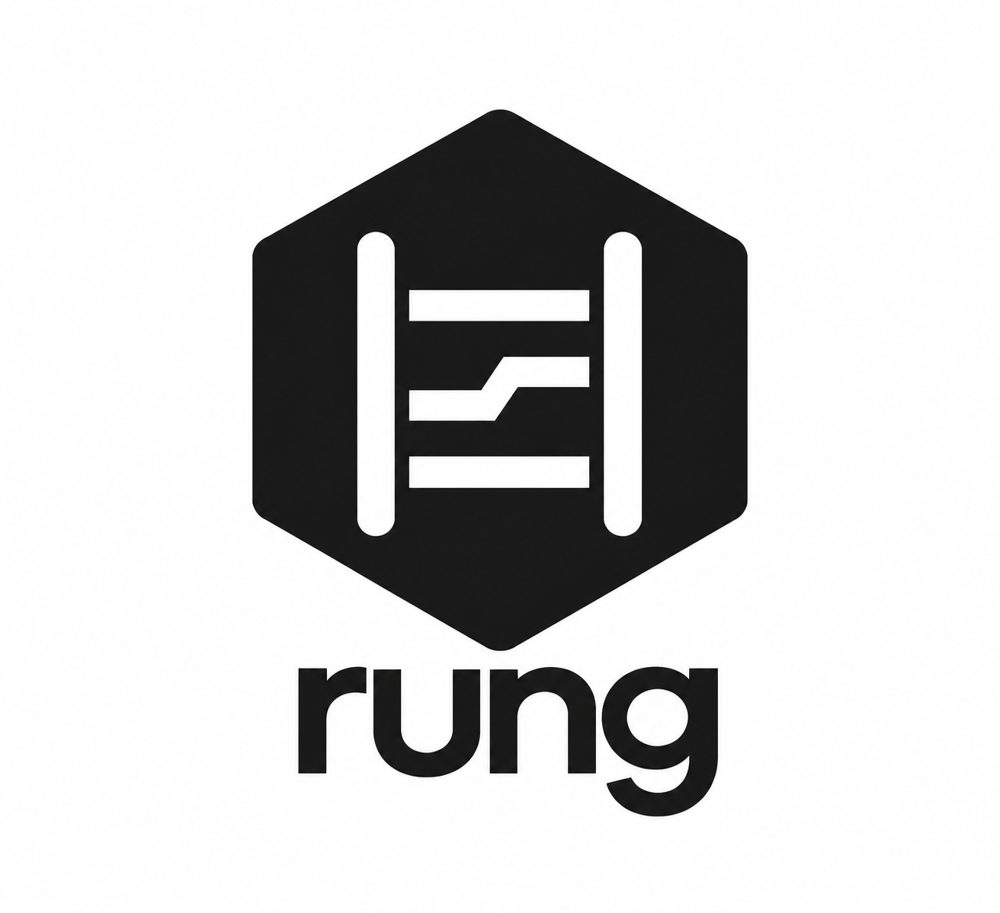
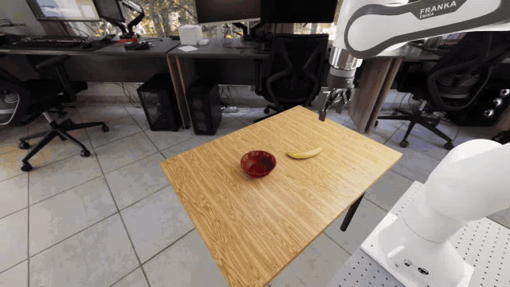

<p align="center">
  
</p>

# Rung

**Run frontier models as robot manipulation policies.**

[](https://github.com/Manda-Robotics/rung/actions/workflows/check.yml)
[](pyproject.toml)
[](LICENSE)
[](docs/README.md)
[](https://docs.astral.sh/ruff/)

Rung connects Gemini, Claude and GPT policies to a robot control loop with bounded
actions, measured execution feedback and auditable traces. Start with a CPU tabletop
mock, then use the same policy interfaces with RoboLab's DROID Franka setup or RoboDojo's
two-arm ARX X5 rig in Isaac Sim.

[Documentation](docs/README.md) · [Quickstart](docs/quickstart.md) ·
[Examples](examples/README.md) · [RoboLab guide](deploy/robolab/README.md) ·
[RoboDojo guide](deploy/robodojo/README.md) ·
[Contributing](CONTRIBUTING.md)



Gemini 4 Argon on RoboLab; native task grade: success. The video shows simulation time,
with physics paused during inference. [Download the complete worked recording](https://github.com/Manda-Robotics/rung/releases/download/v0.1.0/example-robolab-episode.zip)
to inspect the actions, state, model calls and execution receipts.

## Installation

Requires **Python 3.11+**. The offline mock needs no GPU, simulator or API key.
Install from source using [uv](https://docs.astral.sh/uv/getting-started/installation/):

```sh
git clone https://github.com/Manda-Robotics/rung.git
cd rung
uv venv --python 3.12
uv pip install -e .
source .venv/bin/activate
```

Or use pip in an existing virtual environment: `python -m pip install -e .`.
On Windows, activate with `.venv\Scripts\activate`. The core and offline examples run
on a CPU; the RoboLab deployment guide targets Linux with an NVIDIA GPU.

The core depends on NumPy and Pillow. Install optional extras for your workflow:

| Extra | Install | Purpose |
|---|---|---|
| `gemini` | `uv pip install -e ".[gemini]"` | Gemini SDK for L0/L2 |
| `anthropic` | `uv pip install -e ".[anthropic]"` | Claude SDK for L0/L2 |
| `openai` | `uv pip install -e ".[openai]"` | OpenAI SDK for L0/L2 |
| `fast` | `uv pip install -e ".[fast]"` | SciPy acceleration for point-cloud clustering |
| `api` | `uv pip install -e ".[api]"` | Remote API client and wire codec |
| `dev` | `uv pip install -e ".[dev]"` | Tests, branch coverage and Ruff |

The direct Gemini interface uses REST and needs no SDK extra. This is an early release;
pin a commit or release when building on its APIs.

## Quickstart

Run a scripted pick and place and check the mock adapter:

```sh
rung --scene banana_in_bowl --policy scripted --out runs/first
rung-probes --embodiment mock
```

Use the [Python examples](examples/README.md) to create an embodiment, apply budgets,
record an episode, or exercise direct-control tools with a fake model:

```sh
python examples/mock_episode.py
python examples/direct_mock.py
python examples/robodojo_mock.py   # two arms, RoboDojo's call sequence, fake model
```

Have a provisioned Rung API endpoint? Use the [remote episode example](examples/README.md#try-a-provisioned-rung-api)
to connect your local environment, keep its observations and actions, and export a recording.
You can inspect and export the offline example first, without service access:

```sh
python examples/mock_episode.py --out runs/example
python examples/inspect_recording.py runs/example --export runs/episode.zip
```

The mock has calibrated cameras, metric depth, occlusion and a jaw that holds objects
that fit. It has no contact physics, so it checks plumbing and control logic rather
than physical grasp quality. The fake model example completes a fixed tool script;
it does not solve the task or make API requests.

For a real model call, set `GEMINI_API_KEY` and follow the
[paid-model quickstart](docs/quickstart.md#use-a-model). Each episode has decision,
time and dollar limits. In-flight requests can exceed a dollar cap and are still billed.

## Choose a control interface

| Interface | The model chooses | The harness supplies |
|---|---|---|
| **Direct** | Relative/absolute end-effector motions, gripper commands and guarded sequences | Motion bounds, geometry queries, frame transforms and execution receipts |
| **L0** | Absolute gripper poses and gripper commands | Interpolation, clamping and residual reports |
| **L2** | Semantic primitives such as `grasp`, `place` and `move_to` | Grounding, depth measurement, grasp planning, collision checks and verification |

Changing interfaces changes information, action vocabulary and recovery together.
Treat score differences as interface-package effects; see the
[interface reference](docs/interfaces.md) and [evaluation protocol](docs/protocol.md).
L1 point-and-phase control is planned and is not implemented.

## Embodiments

| Embodiment | Arms | Simulator | Interfaces | Guide |
|---|---|---|---|---|
| Tabletop mock | 1 | None, CPU | Direct, L0, L2 | [Quickstart](docs/quickstart.md) |
| RoboLab DROID (Franka) | 1 | Isaac Sim 6.0.1, upstream RoboLab | Direct, L0, L2 | [RoboLab guide](deploy/robolab/README.md) |
| RoboDojo dual ARX X5 | 2 | Isaac Sim 5.1, upstream RoboDojo | Direct (bimanual profile) | [RoboDojo guide](deploy/robodojo/README.md) |

On two arms, every motion and gripper tool takes an `arm`, `move_both` moves both arms in
one motion, and receipts report each arm. The
[interface reference](docs/interfaces.md#two-arms-the-bimanual-direct-profile) lists
what turn-by-turn two-arm control can and cannot do. RoboDojo episodes need a host
driver below 595; the guide explains why.

Models receive RGB images and proprioception, with camera geometry when enabled.
The harness can use depth for geometry queries and primitive execution. These inputs
must be declared when reporting results. The external benchmark scorer decides success;
a model calling `done` does not establish that the task succeeded.

## Run on RoboLab

The [single-GPU RoboLab guide](deploy/robolab/README.md) covers the public Dockerfile,
calibration, adapter probes, a single task and the 120-task suite. It uses a paid Gemini
API key and upstream [RoboLab](https://github.com/NVlabs/RoboLab) with Isaac Sim.
The container recipe requires validation on your GPU and driver stack before a full run.

Benchmark outputs, recordings and intermediate reports are generated locally and are
excluded from this repository.

## Results

Gemini 4 Argon (medium) through the direct interface solved **1,019 of 1,200 RoboLab-120
episodes (84.9%, Wilson 95% interval 82.8 to 86.8)**: 120 tasks x 10 episodes on upstream
RoboLab `9cce00c` with its unmodified grader, Isaac Sim 6.0.1, NVIDIA L40S. Physics is
paused while the model thinks. Every episode, video, grader log and uncounted attempt is in
the [results dataset](https://huggingface.co/datasets/mandarobotics/rung-robolab120-gemini4-argon),
in RoboLab's own output format.

## Inspect and extend

`--out` saves an event trace, per-episode observations, results and run provenance.
Inspect existing evidence with:

```sh
rung-inspect runs/first --out runs/first/inspection.json
```

To run your own model, open-weight or local, implement the three-member `ModelBackend`;
[bring your own model](docs/own-model.md) has a complete backend for any
OpenAI-compatible server (vLLM, SGLang, Ollama). To add a simulator or hardware adapter, implement `Embodiment` (`capabilities`, `reset`,
`observe`, `execute`) and pass the probes. See the
[contract and adapter checklist](docs/contracts.md).

| Directory | Contents |
|---|---|
| [`src/rung/`](src/rung/) | Contracts, policies, backends, perception, executor, loop and adapters |
| [`examples/`](examples/) | Offline runs, remote API use, and recording inspection/export |
| [`docs/`](docs/) | Guides, contracts, protocol and architecture decisions |
| [`deploy/robolab/`](deploy/robolab/) | Dockerfile, calibration, probes and benchmark runners |
| [`deploy/robodojo/`](deploy/robodojo/) | RoboDojo install, one-episode runner and policy-server shim |
| [`configs/`](configs/) | Model profile, dated prices and pinned task metadata |
| [`tasks/`](tasks/) | Task manifests and development/validation/test roles |
| [`tests/`](tests/) | Offline unit and regression suite |

## Development

```sh
uv sync --locked --all-extras
make check
make examples
make coverage
```

CI checks Ruff lint and formatting, tests Python 3.11 through 3.14, records branch
coverage, and builds and installs the package. See [contributing](CONTRIBUTING.md) for
the workflow and [security reporting](SECURITY.md) for vulnerabilities.

## Credits and citation

Built by [Manda Robotics](https://mandarobotics.com). Rung integrates with NVIDIA's
[RoboLab](https://github.com/NVlabs/RoboLab), Isaac Sim and Isaac Lab, and with
[RoboDojo](https://github.com/RoboDojo-Benchmark/RoboDojo) through XPolicyLab. L0 takes
inspiration from RoboCurve's [inspect-robots](https://github.com/robocurve/inspect-robots)
agent policy. L2 draws on MOKA, PIVOT, ReKep, CoPa, SoFar and UniManip.
See [CITATION.cff](CITATION.cff) to cite this software.

## License

[Apache License 2.0](LICENSE). See [NOTICE](NOTICE) for attribution.
